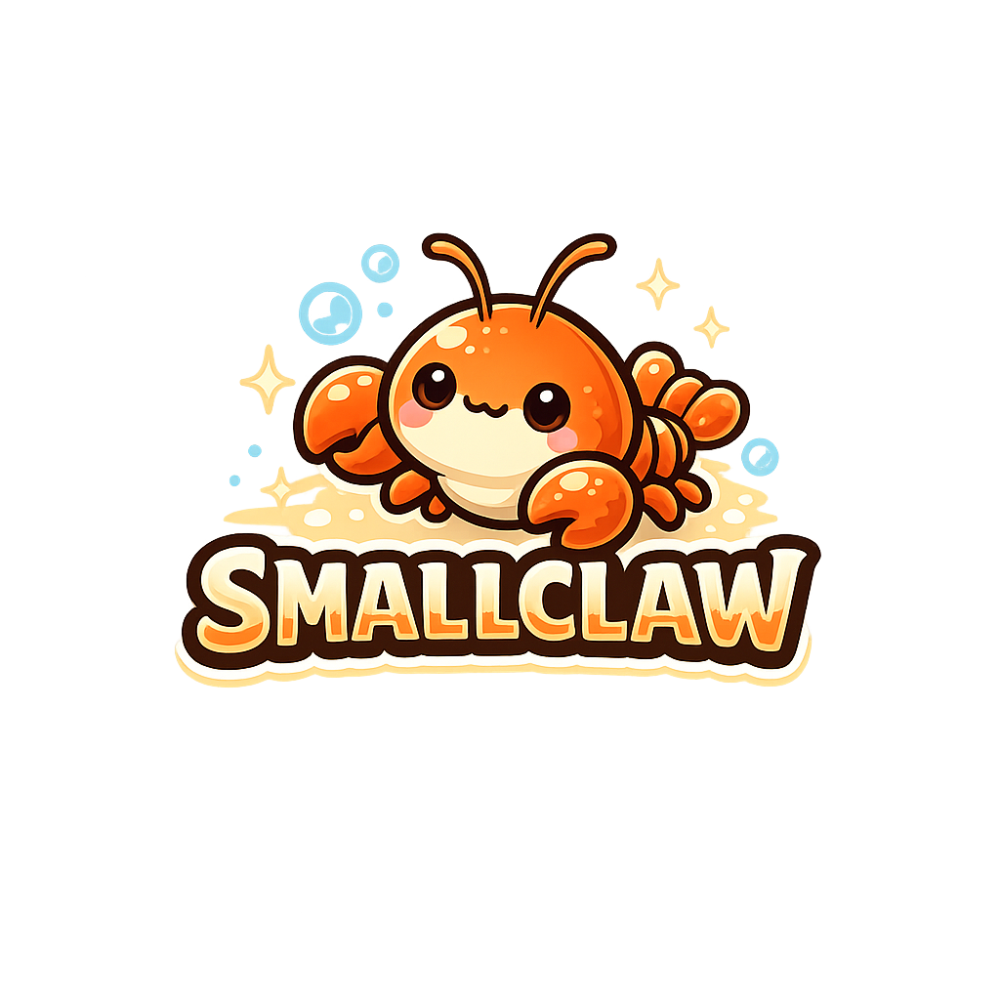
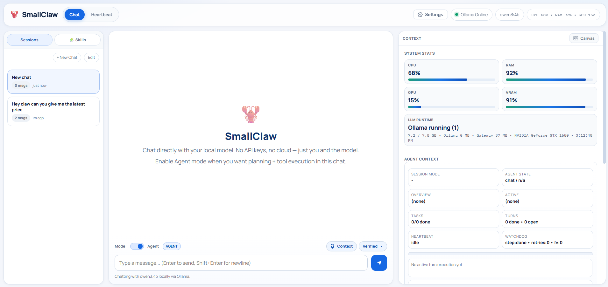

<p align="center">
  
</p>

<h1 align="center">SmallClaw 🦞</h1>

<p align="center">
  Local-first AI agent framework built for small models, with optional hybrid cloud support.
</p>

<p align="center">
  <a href="https://github.com/ylixx/SmallClaw/stargazers">
    
  </a>
  <a href="https://github.com/ylixx/SmallClaw/network/members">
    
  </a>
  <a href="https://github.com/ylixx/SmallClaw/issues">
    
  </a>
  <a href="https://github.com/ylixx/SmallClaw/blob/main/LICENSE">
    
  </a>
</p>

<p align="center">
  <a href="#c-install">安装</a> ·
  <a href="#c-quickstart">快速开始</a> ·
  <a href="#c-arch">架构</a> ·
  <a href="#c-orchestration">多智能体编排</a> ·
  <a href="#c-config">配置</a> ·
  <a href="#c-trouble">排障</a>
  &nbsp;|&nbsp;
  <a href="#e-install">Install</a> ·
  <a href="#e-quickstart">Quick Start</a> ·
  <a href="#e-arch">Architecture</a> ·
  <a href="#e-orchestration">Multi-Agent</a> ·
  <a href="#e-config">Config</a> ·
  <a href="#e-trouble">Troubleshooting</a>
</p>

<p align="center">
  
</p>

<!-- ============================= LANGUAGE SWITCHER ============================= -->
<input type="radio" name="readme-lang" id="tab-zh" checked>
<input type="radio" name="readme-lang" id="tab-en">
<div class="tabbar">
  <label for="tab-zh">🇨🇳 中文</label>
  <label for="tab-en">🇺🇸 English</label>
</div>

<!-- =============================== 中文版 =============================== -->
<div class="lang-zh">

# SmallClaw v1.1

**本地优先的 AI Agent 框架，支持本地 + 云端混合模型** —— 一个运行在你自己机器上的开源 AI 助手替代品，可用免费本地模型驱动，无需 API 费用、数据不出本机。

**当前版本：** `v1.1`

> 图片资源：将两张图放入 `assets/`：`assets/SmallClaw.png`、`assets/SmallClawDashboard.png`

<a id="c-what"></a>
## SmallClaw 是什么？

SmallClaw 是一个以对话为核心的 AI Agent，支持多供应商（Ollama、llama.cpp、LM Studio、OpenAI API、OpenAI Codex OAuth），可在纯本地或混合部署下运行。它赋予本地模型真正的工具能力——文件、网页搜索、浏览器自动化、终端命令、知识库检索、办公文档处理、PPT/图像生成——通过干净的 Web UI 交付，零 API 成本、数据不出本机。

- ✅ **文件操作** —— 行级精度的读取、写入、外科手术式编辑
- ✅ **网页搜索** —— 多供应商瀑布式搜索（Tavily / Google / Brave / DuckDuckGo），带降级兜底
- ✅ **浏览器自动化** —— 完整的 Playwright 浏览器控制（点击、填充、快照）
- ✅ **终端访问** —— 在 workspace 内安全运行命令
- ✅ **知识库 RAG** —— 本地知识库 add/search/列表/删除 + 聊天自动注入
- ✅ **办公生产力** —— 文档 OCR/解析/批量处理、Excel 透视、Markdown→DOCX、PPT 一键生成、图像抠图/压缩/水印
- ✅ **Flows 流程固化** —— 把常用工作流固化为一键模板
- ✅ **多智能体编排** —— 规划 / 执行 / 验证三角色，复杂任务自动升级（可配置开关）
- ✅ **记忆系统** —— 跨会话持久记忆 + 上下文预算
- ✅ **定时任务** —— 内置 Cron 调度器
- ✅ **技能系统** —— 即插即用的 SKILL.md 赋予 Agent 新能力
- ✅ **MCP 集成** —— 从 Web UI 接入任意 MCP 服务器
- ✅ **频道接入** —— Telegram / Discord / WhatsApp + Webhook
- ✅ **永远免费** —— 无 API 成本，跑在你的硬件上

<a id="c-arch"></a>
## 架构

SmallClaw 的核心是一个**单趟对话处理器** `handleChat()`：一次 LLM 调用就决定「直接回答」还是「调用工具」，没有多余的角色协调开销，对小模型非常友好、延迟低。

但框架**同时内置了一套可选的多智能体编排层**（默认关闭，由 `orchestration` 配置段启用）。当任务复杂、或检测到失败/停滞/循环/高风险编辑时，会自动升级为 **规划(planner) → 执行(executor) → 验证(verifier)** 三角色协作，并配合 plan 模式（只读预览）、验证流(verification-flow)与自愈(task-self-healer)。

```
+-----------------------------------------------+
|               Web UI (index.html)             |
|   会话 · 对话 · 流程日志 · 设置 · 知识库 · Flows |
+------------------------+----------------------+
                         |
                   SSE 流 + REST API
                         |
+-----------------------------------------------+
|          Express 网关 (server-v2.ts)           |
|   会话状态 · 工具注册表 · SSE 广播 · 编排调度    |
+------------------------+----------------------+
                         |
            原生工具调用 + 供应商 API
                         |
+-----------------------------------------------+
|         handleChat() — 核心循环（单趟）         |
|  1) 构建系统提示 + 滚动历史（最近 N 轮）        |
|  2) 单次 LLM 调用，暴露工具                    |
|  3) 模型决定：回答 OR 调用工具                 |
|  4) 执行工具 → 流式回传结果                    |
|  5) 重复直到最终回答                           |
|  6) 经 SSE 实时推送到 UI                       |
+-----------------------------------------------+
        |                 |                 |
        v                 v                 v
   文件工具          网页/知识库工具      浏览器/系统工具

  ┌─────────────────────────────────────────────┐
  │ 可选编排层（orchestration，默认关闭）         │
  │  planner → executor → verifier               │
  │  + plan 模式（只读预览） + 验证流 + 自愈       │
  └─────────────────────────────────────────────┘
```

### 一次对话是怎么跑的

默认路径下，每条消息走同一条单趟通道：模型看到系统提示、一段滚动历史（默认最近 5 轮）和你的消息，然后要么纯文本回答，要么发出工具调用。若调用工具，SmallClaw 执行并把结果喂回同一段对话，模型持续进行直到写出最终文本回答，全程以 SSE 事件实时流式推回 UI。

当编排层启用且任务复杂时，会先进入规划/验证子流程，再回到主循环——这是**可选增强**，单趟主循环始终存在。

### 会话状态

每个浏览器会话保存一段滚动消息历史（最近 N 轮）和 workspace 路径。历史刻意保持简短——小模型在紧凑上下文下表现更好。固定消息(pinned)让你把重要上下文永久留在视野里而不臃肿每一轮。

<a id="c-tools"></a>
## 工具系统

SmallClaw 使用 Ollama 原生工具调用格式（也兼容 OpenAI 兼容服务器的 function calling）。模型不写代码执行，而是返回结构化 JSON 工具调用，SmallClaw 在沙箱中运行它，结果作为工具消息回传模型。

### 文件工具
外科手术式编辑：模型被要求先带行号读文件，再做精准修改，避免小模型重写时静默丢内容。

| 工具 | 作用 |
|------|------|
| `list_files` | 列出 workspace 目录内容（支持过滤/排序/摘要） |
| `read_file` | 带行号读取文件 |
| `create_file` | 新建文件（已存在则失败） |
| `replace_lines` | 将第 N–M 行替换为新内容 |
| `insert_after` | 在第 N 行后插入内容 |
| `delete_lines` | 删除第 N–M 行 |
| `find_replace` | 精确查找并替换文本 |
| `delete_file` | 删除文件 |
| `grep_content` | 在文件中搜索内容 |
| `run_code` | 真实代码执行（沙箱） |

### 网页与知识库工具
| 工具 | 作用 |
|------|------|
| `web_search` | 跨供应商搜索，返回标题与摘要 |
| `web_fetch` | 抓取并提取 URL 全文 |
| 知识库工具 | `kb_add` / `kb_search` / `kb_list` / `kb_remove`，聊天自动 RAG 注入 |

搜索采用供应商瀑布：Tavily → Google CSE → Brave → DuckDuckGo。未配密钥时 DuckDuckGo 作为无密钥兜底。

### 浏览器工具
SmallClaw 通过 Playwright 控制真实浏览器——自主导航、填表、快照。

| 工具 | 作用 |
|------|------|
| `browser_open` | 在 Playwright 浏览器中打开 URL |
| `browser_snapshot` | 捕获当前页面元素与布局 |
| `browser_click` | 按引用 ID 点击元素 |
| `browser_fill` | 向输入框键入 |
| `browser_press_key` | 按 Enter / Tab / Escape 等 |
| `browser_wait` | 等待 N 毫秒后快照（动态页面） |
| `browser_close` | 关闭浏览器标签页 |

### 系统 / 办公 / 图像工具
| 工具 | 作用 |
|------|------|
| `run_command` | 为你打开应用或文件（VS Code、记事本、Chrome），SmallClaw 可打开但不可控 |
| `start_task` | 启动多步后台任务，处理长时操作 |
| 办公工具 | 文档 OCR / 解析 / 批量处理、Excel 透视、Markdown→DOCX（`doc_*` 系列） |
| PPT 工具 | 一键生成美化 PPT 演示文稿 |
| 图像工具 | 抠图 / 压缩 / 水印（纯本地 PIL）、HTML/CSS→PNG 渲染 |

<a id="c-orchestration"></a>
## 多智能体编排（内置，可选启用）

SmallClaw **内置**一套多智能体编排系统（不是单纯的「可选技能」）。它由 `.smallclaw/config.json` 的 `orchestration` 段控制：

- **三角色**：`manager`（规划/调度）、`executor`（工具 + 编辑）、`verifier`（验证质量）。对应 `models.roles`。
- **二次模型顾问**：主模型保留为 executor，次模型给出结构化规划/救援建议。
- **预检(preflight)**：可设 `off` / `complex_only` / `always`。
- **触发救援**：连续失败、停滞、循环检测、高风险编辑、无进展时自动触发。
- **Plan 模式**：只读工具直到用户批准 `plan_submit`。
- **验证流(verification-flow) + 自愈(task-self-healer)**：出错/循环时自动恢复。
- **子智能体模式**：`subagent_mode` 可切「保守顺序委派」或「并行多子智能体(Claude Cowork 风格)」。

重要行为：
- 该能力**默认关闭**（`orchestration.enabled: false`）。
- 仅当配置启用且命中触发条件时运行。
- 关闭时，预检/救援/验证后继续等逻辑全部停用——单趟主循环不受影响。

当前安全/质量控制：
- 助手冷却与每轮/每会话上限
- 遥测端点：`GET /api/orchestration/telemetry?sessionId=<id>`
- 验证后继续：防止「仅意图」回复过早结束执行

<a id="c-memory"></a>
## 记忆与上下文

- **跨会话记忆**：持久化聊天记忆，带相关性过滤注入（显式许可头 + 容量上限 + 中文意图识别）。
- **上下文预算**：会话历史与轮内上下文均跟随活跃模型 n_ctx 自适应；最近对话回顾注入。
- **对话记录可真正删除**；记忆文件落在 `.smallclaw/memory/`（gitignored）。

<a id="c-flows"></a>
## Flows 流程固化

把常用工作流一键固化为模板，侧边栏直接运行。支持 Flows 的 CRUD（UI 新建/编辑/删除 + API）。例如「周报生成」可沉淀为可复用的 `weekly-report` 技能。

<a id="c-install"></a>
## 安装

### 前置条件
1. **Node.js** 18+（[下载](https://nodejs.org/)）
2. **至少一个模型供应商**：Ollama / llama.cpp server / LM Studio / OpenAI API key / OpenAI Codex OAuth
3. **至少 8GB 内存**（编码任务建议 16GB+）

### 部署步骤

#### Windows
1. 克隆仓库：`git clone https://github.com/ylixx/SmallClaw.git && cd SmallClaw`
2. 安装依赖：`npm install`
3. 构建：`npm run build`
4. 开机自启：在 Windows 任务计划程序中新建任务，操作为运行：
   ```powershell
   node dist/cli/index.js gateway start
   ```

> **多机器部署（工作区路径）**：工作区默认是 `项目根/workspace`（由代码位置推导，与启动目录无关）。
> `.smallclaw/config.json` 里的 `workspace.path` 会覆盖默认值——**不要把其他机器上的
> `config.json` 一起复制**（其中的绝对路径会让产物写到错误位置）。首次在新机器运行前：
> 删除 `workspace` 字段、或设置环境变量 `SMALLCLAW_WORKSPACE_DIR` 指向本机工作区。
> 启动日志若出现 `WARNING: workspace.path 的父目录不存在` 即说明路径配置来自其他机器。
> 知识库数据目录 `knowledge/`（含用户文档与索引）不入库，在新机器上按需导入即可。

#### macOS
1. 克隆：`git clone https://github.com/ylixx/SmallClaw.git && cd SmallClaw`
2. `npm install` → `npm run build`
3. 开机自启：在 `~/Library/LaunchAgents/com.smallclaw.plist` 创建 LaunchAgent（详见仓库 Dockerfile 同级示例），然后 `launchctl load ~/Library/LaunchAgents/com.smallclaw.plist`

#### Linux
1. 克隆：`git clone https://github.com/ylixx/SmallClaw.git && cd SmallClaw`
2. `npm install` → `npm run build`
3. 开机自启：在 `~/.config/systemd/user/smallclaw.service` 创建 user service，然后：
   ```bash
   systemctl --user daemon-reload
   systemctl --user enable smallclaw
   systemctl --user start smallclaw
   ```

<a id="c-quickstart"></a>
## 快速开始

```bash
# 安装并构建
npm install && npm run build

# 启动网关
npm start
```

浏览器打开 `http://localhost:18789`。

### 1. 拉取模型
```bash
ollama pull qwen3:4b      # 轻量，8GB 内存友好
ollama pull qwen2.5-coder:32b   # 编码更强，需 16GB+
```

### 2. 配置模型与搜索
在 Web UI 打开设置（顶栏 ⚙️）：
- **模型** —— 选供应商 + 模型（Ollama / llama.cpp / LM Studio / OpenAI API / OpenAI Codex OAuth）
- **搜索** —— 填 Tavily / Google / Brave 的 API key 以获得更好结果

### 3. 测试 Webhook
见 [WEBHOOKS.md](./WEBHOOKS.md) 获取 curl 示例与端点测试（跨平台）。

<a id="c-config"></a>
## 配置

配置存于项目目录下的 `.smallclaw/config.json`（或回退到 `~/.smallclaw/config.json`）。

```jsonc
{
  "version": "1.1.0",
  "gateway": {
    "port": 18789,
    "host": "127.0.0.1",
    "auth": { "enabled": false }
  },
  "ollama": {
    "endpoint": "http://localhost:11434",
    "timeout": 120,
    "concurrency": { "llm_workers": 1, "tool_workers": 2 }
  },
  "models": {
    "primary": "qwen3:4b",
    "roles": { "manager": "qwen3:4b", "executor": "qwen3:4b", "verifier": "qwen3:4b" }
  },
  "tools": {
    "enabled": ["list_files", "read_file", "web_search", "browser_open", "run_command"],
    "permissions": { "shell_exec": false }
  },
  "skills": {
    "directory": ".smallclaw/skills",
    "registries": [],
    "auto_update": true
  },
  "memory": {
    "provider": "jsonl",
    "path": ".smallclaw/memory",
    "embedding_model": "nomic-embed-text"
  },
  "heartbeat": { "enabled": false, "interval_minutes": 60, "workspace_file": "HEARTBEAT.md" },
  "workspace": { "path": "path/to/your/workspace" },
  "channels": {
    "telegram": { "enabled": false, "botToken": "", "allowedUserIds": [], "streamMode": "partial" },
    "discord":  { "enabled": false, "botToken": "", "channelId": "" },
    "whatsapp": { "enabled": false, "accessToken": "", "phoneNumberId": "" }
  },
  "search": {
    "preferred_provider": "tavily",
    "tavily_api_key": "",
    "google_api_key": "",
    "brave_api_key": ""
  },
  "llm": {
    "provider": "ollama",
    "providers": {
      "ollama": { "endpoint": "http://localhost:11434", "model": "qwen3:4b" }
    }
  },
  "orchestration": {
    "enabled": false,
    "secondary": { "provider": "", "model": "" },
    "preflight": { "mode": "complex_only", "allow_secondary_chat": false },
    "triggers": { "consecutive_failures": 3, "stagnation_rounds": 5, "loop_detection": true },
    "limits": { "assist_cooldown_rounds": 2, "max_assists_per_turn": 3 },
    "subagent_mode": false
  },
  "plan": { "enabled": true, "timeout_minutes": 30 },
  "office": { "require_preview": true, "preview_row_limit": 50 },
  "image": { "render": { "timeout_ms": 15000 } },
  "agent_policy": { "force_web_for_fresh": true, "auto_store_web_facts": true }
}
```

> 真实配置包含约 20 个顶层键（以上为代表性子集）。多数设置可在「设置」面板实时修改，无需重启网关。

### 配置两段的关系
- **`llm.provider` + `llm.providers.<provider>`** —— *当前*生效的模型链。网关读 `llm.provider` 选供应商与模型，由「设置 → 模型」编辑。
- **`models.primary` / `models.roles`** —— 兼容/兜底字段，作为供应商未指定模型时的回退，并为不同角色（manager/executor/verifier）提供默认模型。

<a id="c-tiers"></a>
## 模型档位（小模型友好）

框架按模型规模自适应上下文窗口、历史长度与工具调用风格：

- **≤4B（small）**：启用两段式短描述、运行时动态裁剪工具集（20 个常开工具拆为 5 核心 + 意图组）、保守上下文。
- **5–9B（mid）**：中等工具集，平衡能力与时延。
- **≥10B（large）**：完整工具集，最强推理/规划。

<a id="c-selfupdate"></a>
## 自更新

```bash
smallclaw update        # 执行更新
smallclaw update check  # 仅检查
```

若你是手动复制/软链的安装，确保命令解析到当前运行的同一份安装。

<a id="c-mcp"></a>
## MCP 集成（设置 → 集成）

从 Web UI 接入 MCP 服务器：**设置 → 集成** 添加服务器与凭证，保存后工具即对 Agent 可用。支持本地/远程服务器、按服务器配置 auth/env、面板内直接测试、常见供应商预设。

<a id="c-channels"></a>
## 频道与 Webhook（设置 → 频道）

在 **设置 → 频道** 用频道选择器管理连接：

- Telegram
- Discord
- WhatsApp

每个频道有独立连接字段与设置说明。逐频道保存设置后，运行 **Test** 再 **Send Test** 验证出站投递与 Webhook 配置。Webhook 端点详见 [WEBHOOKS.md](./WEBHOOKS.md)。

<a id="c-cli"></a>
## CLI 命令

```bash
# 网关
smallclaw gateway start
smallclaw gateway status

# 模型管理
smallclaw model list
smallclaw model set qwen2.5-coder:32b
smallclaw model pull llama-3.3:70b

# 系统
smallclaw doctor
smallclaw update check
smallclaw update
```

<a id="c-skills"></a>
## 技能系统

支持即插即用的 `SKILL.md`：放入 `.smallclaw/skills/<skill-name>/SKILL.md`，相关时模型自动加载应用。技能是纯 Markdown——用自然语言写指令、示例与约束，无需代码。

<a id="c-providers"></a>
## 供应商支持（设置 → 模型）

- `ollama`（本地）
- `llama_cpp`（本地 OpenAI 兼容服务器）
- `lm_studio`（本地 OpenAI 兼容服务器）
- `openai`（API key）
- `openai_codex`（ChatGPT OAuth / Codex 端点）

供应商选择通过 Web 设置 API 实时生效，由统一供应商工厂调用。

<a id="c-reco"></a>
## 模型推荐

### 8GB 内存
- **qwen3:4b** —— 快，日常任务/文件编辑/网页检索扎实

### 16GB 内存
- **qwen2.5-coder:32b** —— 多文件编码与工具编排明显更强
- **deepseek-coder-v2:16b** —— 代码理解强力备选

### 32GB+ 内存
- **llama-3.3:70b** —— 推理与规划最佳，擅长复杂多步任务

<a id="c-optimize"></a>
## 小模型优化

SmallClaw 专为 4B–32B 参数模型约束设计：

- **短历史窗口** —— 默认只发最近 5 轮，保持上下文紧凑
- **行号优先的文件编辑** —— 强制先读后写，防止丢内容
- **原生工具调用** —— 用 Ollama 结构化工具格式，比自由代码生成在小规模下可靠得多
- **单趟路由** —— 一次 LLM 调用决定用工具还是回答，无多角色协调开销（复杂任务可叠加可选编排层）
- **手术式编辑** —— 对已有文件用 `replace_lines`/`insert_after`/`delete_lines` 而非整体重写

<a id="c-docker"></a>
## Docker 部署

```bash
docker compose down
docker compose build --no-cache
docker compose --profile ollama up -d
```

随后浏览器打开 `http://your-server-ip:18789`。容器内固定监听 **18789**，用 `HOST_PORT` 映射宿主机端口。详见仓库内 `docker-compose.yml` 与 `.env` 示例。

> **重要**：容器内服务器必须绑定 `0.0.0.0`（由 `DOCKER_CONTAINER=true` 自动处理），否则端口映射后仍不可达。

<a id="c-trouble"></a>
## 排障

### “无法连接 Ollama”
```bash
ollama serve
curl http://localhost:11434/api/tags
```

### 设置里 “找不到模型”
```bash
ollama pull qwen3:4b
ollama list
```

### “内存不足 / 模型崩溃”
- 降到更小模型（qwen3:4b 替代 32b）
- 关闭其他吃内存应用
- 多用户并发时在配置设 `ollama.concurrency.llm_workers: 1`

### 工具调用不生效 / 模型只聊天
- 检查「设置 → 模型」确认已选并保存模型
- qwen3 / qwen2.5-coder 系列工具调用最稳；持续忽略则换更大变体

### Docker：容器启动后 UI 不可达
1. **绑定地址** 须为 `0.0.0.0`（容器内）。
2. **端口映射** 用 `HOST_PORT`（非 `GATEWAY_PORT`）改宿主机端口。
3. **镜像陈旧** → `docker compose build --no-cache` 重建。

<a id="c-roadmap"></a>
## 路线图

- [x] 单趟原生工具调用架构（核心）
- [x] 会话式聊天 UI
- [x] 行级精度文件编辑
- [x] 多供应商瀑布式网页搜索
- [x] Playwright 浏览器自动化
- [x] 技能系统（SKILL.md）
- [x] UI 实时设置（模型/搜索/路径）
- [x] 知识库 RAG（本地）
- [x] Flows 流程固化
- [x] 办公/文档工具（OCR/解析/Excel/PPT）
- [x] 图像工具（抠图/压缩/水印/渲染）
- [x] 记忆系统 + 上下文预算
- [x] 定时任务（Cron 调度器）
- [x] 多智能体编排层（规划/执行/验证 + 自愈）
- [x] MCP 集成、Telegram/Discord/WhatsApp 频道
- [ ] 跨网关重启的持久会话
- [ ] 后台任务守护进程模式
- [ ] Git 操作工具
- [ ] 桌面应用封装

<a id="c-contrib"></a>
## 贡献 / 许可 / 致谢

- **许可**：MIT
- **致谢**：受 [OpenClaw](https://openclaw.ai) 与 Anthropic 团队启发，为本地优先 AI 社区而建。
- **贡献**：欢迎 Issue / PR。

---

*本 README 同时提供中文与 English 两版，点击顶部标签切换。反映 SmallClaw `v1.1.0`。*

</div>
<!-- =============================== /中文版 =============================== -->

<!-- =============================== ENGLISH版 =============================== -->
<div class="lang-en">

# SmallClaw v1.1

**Local-first AI agent framework with local + cloud provider support** — an open source alternative to cloud AI assistants that runs on your machine with free local models.

**Current release:** `v1.1`

> Image setup: put the two images in `assets/`:
> - `assets/SmallClaw.png`
> - `assets/SmallClawDashboard.png`

<a id="e-what"></a>
## What is SmallClaw?

SmallClaw is a chat-first AI agent that supports multiple providers for local-only or hybrid setups (Ollama, llama.cpp, LM Studio, OpenAI API, and OpenAI Codex OAuth). It gives your local model real tools — files, web search, browser automation, terminal commands, knowledge-base retrieval, office document processing, PPT/image generation — delivered through a clean web UI with no API costs, no data leaving your machine.

- ✅ **File operations** — Read, write, and surgically edit files with line-level precision
- ✅ **Web search** — Multi-provider search (Tavily, Google, Brave, DuckDuckGo) with fallback
- ✅ **Browser automation** — Full Playwright-powered browser control (click, fill, snapshot)
- ✅ **Terminal access** — Run commands in your workspace safely
- ✅ **Knowledge Base (RAG)** — Local KB add/search/list/remove + auto chat injection
- ✅ **Office productivity** — doc OCR/parse/batch, Excel pivot, Markdown→DOCX, one-click PPT, image matting/compress/watermark
- ✅ **Flows** — One-click workflow templates
- ✅ **Multi-Agent Orchestration** — planner/executor/verifier roles, auto-escalation for complex tasks (config-gated)
- ✅ **Memory system** — Persistent cross-session memory + context budget
- ✅ **Scheduled tasks** — Built-in Cron scheduler
- ✅ **Skills system** — Drop-in SKILL.md files to give the agent new capabilities
- ✅ **MCP integrations** — Connect any MCP server from the web UI
- ✅ **Channels** — Telegram / Discord / WhatsApp + Webhook
- ✅ **Free forever** — No API costs, runs on your hardware

<a id="e-arch"></a>
## Architecture

SmallClaw's core is a **single-pass chat handler** `handleChat()`: one LLM call decides whether to respond conversationally or call tools — no extra role-coordination overhead, friendly to small models with low latency.

But the framework **also ships a built-in multi-agent orchestration layer** (off by default, enabled via the `orchestration` config section). When a task is complex, or failures/stagnation/loops/risky edits are detected, it auto-escalates to a **planner → executor → verifier** triad, with plan mode (read-only preview), verification-flow, and task-self-healer.

```
+-----------------------------------------------+
|               Web UI (index.html)             |
|   Sessions · Chat · Process Log · Settings ·  |
|   Knowledge · Flows                            |
+------------------------+----------------------+
                         |
                   SSE stream + REST API
                         |
+-----------------------------------------------+
|          Express Gateway (server-v2.ts)       |
|   Session state · Tool registry · SSE ·        |
|   Orchestration scheduler                      |
+------------------------+----------------------+
                         |
            Native tool-calling + provider API
                         |
+-----------------------------------------------+
|         handleChat() — core loop (single-pass) |
|  1) Build system prompt + short history        |
|  2) Single LLM call with tools exposed         |
|  3) Model decides: respond OR call tool(s)     |
|  4) Execute tool → stream result back          |
|  5) Repeat until final response                |
|  6) Stream final text to UI via SSE            |
+-----------------------------------------------+
        |                 |                 |
        v                 v                 v
   File Tools        Web/KB Tools      Browser/System Tools

  ┌─────────────────────────────────────────────┐
  │ Optional orchestration layer (off by default)│
  │  planner → executor → verifier               │
  │  + plan mode + verification-flow + self-heal │
  └─────────────────────────────────────────────┘
```

### How a turn works

On the default path, every message goes through the same single-pass channel. The model sees the system prompt, a short rolling history (last 5 turns by default), and your message. It then either responds in plain text or emits a tool call. If it calls a tool, SmallClaw executes it and feeds the result back into the same conversation — the model keeps going until it writes a final text response, streamed to the UI in real time as SSE events.

When the orchestration layer is enabled and the task is complex, it first enters a planning/verification sub-flow before returning to the main loop — this is an **optional enhancement**; the single-pass core always exists.

### Session state

Each browser session stores a rolling message history (last N turns) and a workspace path. History is kept short on purpose — small models perform better with compact context. Pinned messages let you keep important context permanently in scope without bloating every turn.

<a id="e-tools"></a>
## How the Tools Work

SmallClaw uses Ollama's native tool-calling format (function calling also works on OpenAI-compatible servers). The model doesn't write code to execute — it returns a structured JSON tool call, SmallClaw runs it in a sandbox, and the result goes back as a tool message.

### File Tools
Surgical editing: the model is instructed to always read a file with line numbers first, then make targeted edits rather than rewriting entire files.

| Tool | What it does |
|------|-------------|
| `list_files` | List workspace contents (filter/sort/summarize) |
| `read_file` | Read file with line numbers |
| `create_file` | Create a new file (fails if exists) |
| `replace_lines` | Replace lines N–M with new content |
| `insert_after` | Insert content after line N |
| `delete_lines` | Delete lines N–M |
| `find_replace` | Find exact text string and replace it |
| `delete_file` | Delete a file |
| `grep_content` | Search content inside files |
| `run_code` | Real sandboxed code execution |

### Web & Knowledge-Base Tools
| Tool | What it does |
|------|-------------|
| `web_search` | Search across providers — headlines and snippets |
| `web_fetch` | Fetch and extract the full text of a URL |
| KB tools | `kb_add` / `kb_search` / `kb_list` / `kb_remove` with auto RAG injection |

Search uses a provider waterfall: Tavily → Google CSE → Brave → DuckDuckGo. DuckDuckGo runs without a key as a baseline fallback.

### Browser Tools
SmallClaw controls a real browser via Playwright — navigating, filling forms, and taking snapshots itself.

| Tool | What it does |
|------|-------------|
| `browser_open` | Open a URL in a Playwright-controlled browser |
| `browser_snapshot` | Capture current page elements and layout |
| `browser_click` | Click an element by reference ID |
| `browser_fill` | Type into an input field |
| `browser_press_key` | Press Enter, Tab, Escape, etc. |
| `browser_wait` | Wait N ms then snapshot (dynamic pages) |
| `browser_close` | Close the browser tab |

### System / Office / Image Tools
| Tool | What it does |
|------|-------------|
| `run_command` | Open an app or file for you to interact with (VS Code, Notepad, Chrome). SmallClaw can open it but not control it. |
| `start_task` | Launch a multi-step background task for long-running operations |
| Office tools | doc OCR / parse / batch, Excel pivot, Markdown→DOCX (`doc_*` suite) |
| PPT tools | One-click polished PPT generation |
| Image tools | matting / compress / watermark (local PIL), HTML/CSS→PNG render |

<a id="e-orchestration"></a>
## Multi-Agent Orchestration (Built-in, optional)

SmallClaw **ships** a multi-agent orchestration system (not merely an optional skill). It is controlled by the `orchestration` section of `.smallclaw/config.json`:

- **Triad roles**: `manager` (plan/schedule), `executor` (tools + edits), `verifier` (quality) — mapped via `models.roles`.
- **Secondary-model advisor**: primary stays executor; secondary gives structured planner/rescue guidance.
- **Preflight**: `off` / `complex_only` / `always`.
- **Rescue triggers**: consecutive failures, stagnation, loop detection, risky edits, no progress.
- **Plan mode**: read-only tools until the user approves `plan_submit`.
- **Verification-flow + task-self-healer**: auto-recovery on errors/loops.
- **Sub-agent mode**: `subagent_mode` switches between conservative sequential delegation and parallel multi-subagent (Claude Cowork-style).

Important behavior:
- This capability is **off by default** (`orchestration.enabled: false`).
- It only runs when enabled in config and a trigger condition is met.
- When disabled, preflight/rescue/post-check continuation logic is disabled — the single-pass core is unaffected.

Current safety/quality controls:
- Assist cooldown and per-turn/session caps
- Telemetry endpoint: `GET /api/orchestration/telemetry?sessionId=<id>`
- Post-check continuation: prevents intent-only replies from ending execution early

<a id="e-memory"></a>
## Memory & Context

- **Cross-session memory**: persistent chat memory with relevance-filtered injection (explicit consent header + capacity cap + intent recognition).
- **Context budget**: session history and intra-turn context both adapt to the active model's n_ctx; recent-conversation recap injection.
- **Conversation records can be truly deleted**; memory files live in `.smallclaw/memory/` (gitignored).

<a id="e-flows"></a>
## Flows

Solidify common workflows into one-click templates, runnable from the sidebar. Full CRUD (UI create/edit/delete + API). E.g. a "weekly report" flow can be distilled into a reusable `weekly-report` skill.

<a id="e-install"></a>
## Installation

### Prerequisites
1. **Node.js** 18+ ([Download](https://nodejs.org/))
2. **At least one model provider**: Ollama / llama.cpp server / LM Studio / OpenAI API key / OpenAI Codex OAuth
3. **At least 8GB RAM** (16GB+ recommended for coding)

### Setup

#### Windows
1. Clone: `git clone https://github.com/ylixx/SmallClaw.git && cd SmallClaw`
2. `npm install` → `npm run build`
3. Auto-start: create a Windows Task Scheduler task running:
   ```powershell
   node dist/cli/index.js gateway start
   ```

> **Multi-machine deployment (workspace path):** the workspace defaults to `project_root/workspace` (derived from code location, independent of launch dir). `workspace.path` in `.smallclaw/config.json` overrides it — **do not copy another machine's `config.json`** (its absolute paths would write artifacts to the wrong place). Before first run on a new machine: delete the `workspace` field, or set `SMALLCLAW_WORKSPACE_DIR` to the local workspace. A `WARNING: workspace.path parent does not exist` log line means the path came from another machine. The `knowledge/` data dir (user docs + index) is not committed — import as needed on the new machine.

#### macOS
1. Clone: `git clone https://github.com/ylixx/SmallClaw.git && cd SmallClaw`
2. `npm install` → `npm run build`
3. Auto-start: create `~/Library/LaunchAgents/com.smallclaw.plist` (see the example beside the Dockerfile), then `launchctl load ~/Library/LaunchAgents/com.smallclaw.plist`

#### Linux
1. Clone: `git clone https://github.com/ylixx/SmallClaw.git && cd SmallClaw`
2. `npm install` → `npm run build`
3. Auto-start: create `~/.config/systemd/user/smallclaw.service`, then:
   ```bash
   systemctl --user daemon-reload
   systemctl --user enable smallclaw
   systemctl --user start smallclaw
   ```

<a id="e-quickstart"></a>
## Quick Start

```bash
# Install and build
npm install && npm run build

# Start the gateway
npm start
```

Open `http://localhost:18789` in your browser.

### 1. Pull a model
```bash
ollama pull qwen3:4b          # Lightweight — great for 8GB RAM
ollama pull qwen2.5-coder:32b # Better at code — needs 16GB+ RAM
```

### 2. Configure models and search
In the web UI, open Settings (⚙️ in the top bar):
- **Models** — choose provider + model (Ollama, llama.cpp, LM Studio, OpenAI API, or OpenAI Codex OAuth)
- **Search** — add API keys for Tavily, Google, or Brave for better web search

### 3. Test webhooks
See [WEBHOOKS.md](./WEBHOOKS.md) for curl examples and webhook endpoint testing (cross-platform).

<a id="e-config"></a>
## Configuration

Config is stored in `.smallclaw/config.json` in the project folder (or `~/.smallclaw/config.json` as a fallback):

```jsonc
{
  "version": "1.1.0",
  "gateway": {
    "port": 18789,
    "host": "127.0.0.1",
    "auth": { "enabled": false }
  },
  "ollama": {
    "endpoint": "http://localhost:11434",
    "timeout": 120,
    "concurrency": { "llm_workers": 1, "tool_workers": 2 }
  },
  "models": {
    "primary": "qwen3:4b",
    "roles": { "manager": "qwen3:4b", "executor": "qwen3:4b", "verifier": "qwen3:4b" }
  },
  "tools": {
    "enabled": ["list_files", "read_file", "web_search", "browser_open", "run_command"],
    "permissions": { "shell_exec": false }
  },
  "skills": {
    "directory": ".smallclaw/skills",
    "registries": [],
    "auto_update": true
  },
  "memory": {
    "provider": "jsonl",
    "path": ".smallclaw/memory",
    "embedding_model": "nomic-embed-text"
  },
  "heartbeat": { "enabled": false, "interval_minutes": 60, "workspace_file": "HEARTBEAT.md" },
  "workspace": { "path": "path/to/your/workspace" },
  "channels": {
    "telegram": { "enabled": false, "botToken": "", "allowedUserIds": [], "streamMode": "partial" },
    "discord":  { "enabled": false, "botToken": "", "channelId": "" },
    "whatsapp": { "enabled": false, "accessToken": "", "phoneNumberId": "" }
  },
  "search": {
    "preferred_provider": "tavily",
    "tavily_api_key": "",
    "google_api_key": "",
    "brave_api_key": ""
  },
  "llm": {
    "provider": "ollama",
    "providers": {
      "ollama": { "endpoint": "http://localhost:11434", "model": "qwen3:4b" }
    }
  },
  "orchestration": {
    "enabled": false,
    "secondary": { "provider": "", "model": "" },
    "preflight": { "mode": "complex_only", "allow_secondary_chat": false },
    "triggers": { "consecutive_failures": 3, "stagnation_rounds": 5, "loop_detection": true },
    "limits": { "assist_cooldown_rounds": 2, "max_assists_per_turn": 3 },
    "subagent_mode": false
  },
  "plan": { "enabled": true, "timeout_minutes": 30 },
  "office": { "require_preview": true, "preview_row_limit": 50 },
  "image": { "render": { "timeout_ms": 15000 } },
  "agent_policy": { "force_web_for_fresh": true, "auto_store_web_facts": true }
}
```

> The real config has roughly 20 top-level keys (the above is a representative subset). Most settings can be changed live from the Settings panel without restarting the gateway.

### How the two config layers relate
- **`llm.provider` + `llm.providers.<provider>`** — the *active* model chain. The gateway reads `llm.provider` to pick provider + model; this is what Settings → Models edits.
- **`models.primary` / `models.roles`** — compatibility/fallback fields used when a provider entry has no model, and as defaults for the manager/executor/verifier roles.

<a id="e-tiers"></a>
## Model Tiers (small-model friendly)

The framework auto-adapts context window, history length, and tool-calling style to model size:

- **≤4B (small)** — two-stage short descriptions, runtime tool-set pruning (20 always-on tools split into 5 core + intent groups), conservative context.
- **5–9B (mid)** — balanced tool set between capability and latency.
- **≥10B (large)** — full tool set, strongest reasoning/planning.

<a id="e-selfupdate"></a>
## Self-Updating

```bash
smallclaw update        # apply updates
smallclaw update check  # check only
```

If your install was manually copied or symlinked, make sure the command resolves to the same install you are running.

<a id="e-mcp"></a>
## MCP Integrations (Settings → Integrations)

SmallClaw supports MCP server connections from the web UI. Open **Settings → Integrations** to add servers and credentials. Supports local/remote servers, per-server auth/env, in-panel testing, and presets for common providers. MCP tools become available to the agent after saving valid settings.

<a id="e-channels"></a>
## Webhook Channels (Settings → Channels)

Channel connections are managed in **Settings → Channels** with a channel selector:
- Telegram
- Discord
- WhatsApp

Each channel has its own connection fields and setup instructions. Save per channel, run **Test**, then **Send Test** to verify outbound delivery and webhook configuration. See [WEBHOOKS.md](./WEBHOOKS.md) for endpoints.

<a id="e-cli"></a>
## CLI Commands

```bash
# Gateway
smallclaw gateway start
smallclaw gateway status

# Model Management
smallclaw model list
smallclaw model set qwen2.5-coder:32b
smallclaw model pull llama-3.3:70b

# System
smallclaw doctor
smallclaw update check
smallclaw update
```

<a id="e-skills"></a>
## Skills

SmallClaw supports drop-in `SKILL.md` files that give the model extra context and capabilities for specific domains. Place skill files in `.smallclaw/skills/<skill-name>/SKILL.md`. The model loads and applies them automatically when relevant. Skills are plain markdown — write instructions, examples, and constraints in natural language. No code required.

<a id="e-providers"></a>
## Provider Support

SmallClaw supports these providers in Settings → Models:
- `ollama` (local)
- `llama_cpp` (local OpenAI-compatible server)
- `lm_studio` (local OpenAI-compatible server)
- `openai` (API key)
- `openai_codex` (ChatGPT OAuth/Codex endpoint)

Provider selection is live through the web settings API and used by the unified provider factory.

<a id="e-reco"></a>
## Model Recommendations

### 8GB RAM
- **qwen3:4b** — Fast, solid for everyday tasks, file editing, web lookups

### 16GB RAM
- **qwen2.5-coder:32b** — Noticeably better at multi-file code tasks and tool sequencing
- **deepseek-coder-v2:16b** — Strong alternative for code understanding

### 32GB+ RAM
- **llama-3.3:70b** — Best reasoning and planning, handles complex multi-step tasks well

<a id="e-optimize"></a>
## Optimizing for Small Models

SmallClaw is specifically designed around the constraints of 4B–32B parameter models:
- **Short history window** — Only the last 5 turns are sent by default, keeping context tight
- **Line-number-first file editing** — Forces the model to read before writing, preventing content loss
- **Native tool-calling** — Uses Ollama's structured tool format instead of free-form code generation
- **Single-pass routing** — One LLM call decides whether to use tools or respond (complex tasks may layer the optional orchestration on top)
- **Surgical edits over rewrites** — `replace_lines`, `insert_after`, `delete_lines` instead of `write_file`

<a id="e-docker"></a>
## Docker Setup

```bash
docker compose down
docker compose build --no-cache
docker compose --profile ollama up -d
```

Then open `http://your-server-ip:18789`. The container always listens on **18789** internally; use `HOST_PORT` to remap on the host. See `docker-compose.yml` and the `.env` example in the repo.

> **Important:** Inside Docker, the server must bind to `0.0.0.0` (handled automatically via `DOCKER_CONTAINER=true`), otherwise it is unreachable even with port mapping.

<a id="e-trouble"></a>
## Troubleshooting

### "Cannot connect to Ollama"
```bash
ollama serve
curl http://localhost:11434/api/tags
```

### "No models found" in Settings
```bash
ollama pull qwen3:4b
ollama list
```

### "Out of memory / model crashes"
- Drop to a smaller model (qwen3:4b instead of 32b)
- Close other memory-intensive apps
- Set `ollama.concurrency.llm_workers: 1` if you have multiple concurrent users

### Tool calls not working / model just chatting
- Check Settings → Models and confirm a model is selected and saved
- qwen3 and qwen2.5-coder series handle tool-calling most reliably; try a larger variant if it keeps ignoring calls

### Docker: Web UI unreachable after container starts
1. **Bind address** must be `0.0.0.0` inside Docker.
2. **Port mismatch** — use `HOST_PORT` (not `GATEWAY_PORT`) to remap on your machine.
3. **Stale image** — rebuild with `--no-cache`: `docker compose build --no-cache`.

<a id="e-roadmap"></a>
## Roadmap

- [x] Single-pass native tool-calling architecture (core)
- [x] Session-based chat UI
- [x] File editing with line-level precision
- [x] Web search with multi-provider fallback
- [x] Playwright browser automation
- [x] Skills system (SKILL.md)
- [x] Live settings (model, search, paths) from UI
- [x] Knowledge Base RAG (local)
- [x] Flows workflow templates
- [x] Office/doc tools (OCR/parse/Excel/PPT)
- [x] Image tools (matting/compress/watermark/render)
- [x] Memory system + context budget
- [x] Scheduled tasks (Cron scheduler)
- [x] Multi-agent orchestration layer (plan/execute/verify + self-heal)
- [x] MCP integrations, Telegram/Discord/WhatsApp channels
- [ ] Persistent sessions (survive gateway restarts)
- [ ] Background task daemon mode
- [ ] Git operations tool
- [ ] Desktop app wrapper

<a id="e-contrib"></a>
## Contributing / License / Credits

- **License**: MIT
- **Credits**: Inspired by [OpenClaw](https://openclaw.ai) and the Anthropic team. Built for the local-first AI community.
- **Contributing**: Issues and PRs welcome.

---

*This README ships both 中文 and English; switch via the tab at the top. Reflects SmallClaw `v1.1.0`.*

</div>
<!-- =============================== /ENGLISH版 =============================== -->

<style>
/* Language switcher tabs — works in VS Code / WorkBuddy / Typora previews.
   On GitHub (which strips <style>/<input>), both language blocks render fully. */
#tab-zh:checked ~ .lang-zh,
#tab-en:checked ~ .lang-en { display: block; }
.lang-zh, .lang-en { display: none; }

.tabbar {
  margin: 14px 0;
  border-bottom: 2px solid #d0d7de;
  padding-bottom: 0;
}
.tabbar label {
  display: inline-block;
  padding: 8px 18px;
  margin-bottom: -2px;
  border: 1px solid #d0d7de;
  border-bottom: none;
  border-radius: 8px 8px 0 0;
  cursor: pointer;
  font-weight: 600;
  background: #f6f8fa;
  color: #57606a;
}
#tab-zh:checked ~ .tabbar label[for="tab-zh"],
#tab-en:checked ~ .tabbar label[for="tab-en"] {
  background: #1f883d;
  color: #fff;
  border-color: #1f883d;
}
input[name="readme-lang"] { position: absolute; opacity: 0; pointer-events: none; }
</style>
